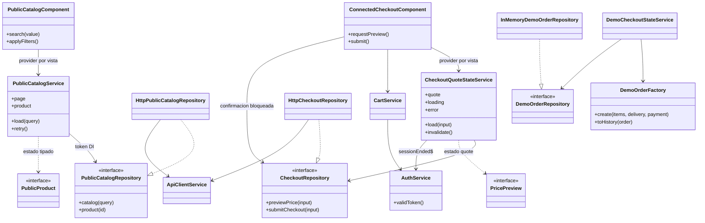

# Arquitectura y patrones demostrables

## Alcance y criterio académico

Angular standalone 22.2, Ionic 9, Capacitor 8.5 y RxJS; backend Spring Boot/PostgreSQL existente. Ionic aporta componentes móviles, Angular presentación/reactividad/DI y Capacitor el contenedor Android. Esta combinación permite APK nativo con UI web, pero **no es Flutter, React Native ni Kotlin**. Si el instrumento limita expresamente los frameworks a esos tres, se necesita aceptación docente del stack; no se presupone equivalencia normativa.

La aplicación tiene arquitectura modular por funcionalidades y separación incremental de presentación, estado de aplicación, contratos/modelos y adaptadores HTTP. No se afirma Clean Architecture estricta: varios InjectionToken de `core/repositories` importan adaptadores concretos para su factory predeterminada; modelos de consulta de catálogo aún viven en `core/api`; algunas vistas conservan orquestación y formularios.

Existe correspondencia MVVM comprobable en determinados recorridos, no una conversión cosmética de toda la aplicación:

| Papel | Clases / archivos reales | Responsabilidad |
|---|---|---|
| Model | `PublicProduct`, `PricePreview`, `Cart`, `RealOrder`; `core/models/` | Datos tipados; no dibujan UI |
| View | Plantillas `public-catalog.view.html`, `public-home.view.html`; template de `ConnectedCheckoutComponent` | Renderiza estados, enlaces y eventos; sin construir JSON de respuesta |
| Estado con papel de ViewModel | `PublicCatalogService`; `CheckoutQuoteStateService` | Señales readonly/computed; loading/ready/error; comandos, reintento y cancelación; provistos por vista |
| Aplicación / estado compartido | `CartService`, `AuthService`, `DemoCheckoutStateService` | Reglas de cantidad, sesión, coordinación de repositorios y limpieza |
| Puertos | `PublicCatalogRepository`, `CheckoutRepository`, `ReviewRepository`, `DemoOrderRepository` | Operaciones que consumen los servicios, sustituibles por DI |
| Infraestructura | `HttpPublicCatalogRepository`, `HttpCheckoutRepository`, `HttpReviewRepository`, `InMemoryDemoOrderRepository`, `MemorySessionStore` | Transporte, validación JSON, mapeo y memoria; sin componentes Ionic |

## Mejora incremental del cierre

`CheckoutQuoteStateService` se extrae porque había una carrera real: la vista ignoraba un cambio de entrega cuando una cotización estaba en curso. Ahora posee estado por instancia de Checkout, cancela respuestas obsoletas con `switchMap`, limpia importes cuando cambia el destino, finaliza con la vista y descarta datos al terminar la sesión. La vista mantiene formularios y confirmación bloqueada. No se cambian endpoints ni se activa una compra. Pruebas específicas demuestran el beneficio; no se renombra una clase para simular MVVM.

## Diagrama de clases y dependencias reales

Los tokens resuelven el adaptador en su factory; las dependencias anteriores describen consumo en ejecución. Esa configuración no convierte los contratos en dominio completamente independiente de infraestructura.

## Singleton

`CartService`, `AuthService`, `DemoOrderFactory` y los adaptadores HTTP declaran `@Injectable({providedIn:'root'})`. Angular comparte una instancia por inyector raíz: todos los tabs observan el mismo carrito y el logout limpia su estado común. No significa un singleton global entre procesos ni sesiones. `PublicCatalogService` y `CheckoutQuoteStateService` son deliberadamente **por vista**, para no cruzar filtros/cotizaciones de pantallas distintas. Evidencia: `core/services/cart.service.ts`, `auth.service.ts`; pruebas de carrito, logout y navegación.

## Factory

`DemoOrderFactory.create()` valida productos/cantidades/precios/entrega/pago, crea un identificador `DEMO-`, copias independientes y totales. `toHistory()` crea la representación de historial. Centraliza invariantes y evita referencias compartidas; el servicio DEMO no reconstruye pedidos de maneras distintas. Es una **Simple Factory**, no Abstract Factory ni el patrón GoF Factory Method con subclases. Su alcance es exclusivamente DEMO; jamás transforma un producto real en pedido ficticio ni genera cobros. Pruebas: `core/factories/demo-order.factory.spec.ts` (validez, excepciones, límites y copias).

## Repository

`PublicCatalogRepository` define categorías, páginas, detalle, novedades y destacados. `HttpPublicCatalogRepository` implementa HTTP, parámetros y validación/mapeo JSON. `PublicCatalogService` consume el token; sus pruebas sustituyen el puerto sin depender de un servidor. Lo mismo aplica a Checkout y reseñas. `DemoOrderRepository` tiene implementación en memoria explícita, no fallback silencioso del real. Ventajas: contrato verificable, aislamiento de transporte y tests deterministas. Evidencia: `core/repositories/`, `core/infrastructure/`, specs HTTP y del servicio de catálogo.

## Observer

RxJS `Subject` emite consultas; `switchMap` reemplaza suscripciones obsoletas; los consumidores actualizan Signals y las plantillas reaccionan. `sessionEnded$` notifica a carrito/cotización/intención de compra para limpiar estado. `takeUntilDestroyed` libera las suscripciones de estado por vista. Signals/computed expresan reactividad, sin afirmar que sean el Observer GoF implementado manualmente. Ventajas: UI sincronizada y respuestas atrasadas descartadas. Pruebas: catálogo fuera de orden, cotizaciones canceladas, destrucción de vista y cierre de sesión.

## Recorrido concreto

Evento buscar → Router/queryParamMap → `PublicCatalogComponent` → `PublicCatalogService.load()` → `PUBLIC_CATALOG_REPOSITORY` → adaptador HTTP → `ApiClientService` → API REST → validador/mapper → estado reactivo → plantilla. En privado, el interceptor añade JWT sólo al backend configurado y el servidor sigue siendo autoridad de autorización. Las pruebas HTTP controladas no demuestran esa autoridad real.

La evolución hacia Clean estricta requeriría mover composición de adaptadores a un punto externo y completar casos de uso/ViewModels donde hoy hay orquestación en componentes. No es necesario reescribir el producto para presentar honestamente la separación y los cuatro patrones actuales; la aceptación del criterio estricto permanece pendiente.
