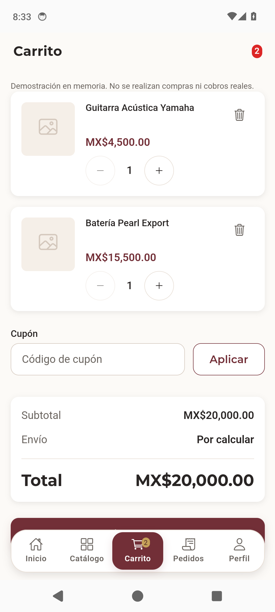

# Etapa 1C — corrección de aceptación Android DEMO

Fecha: 3 de noviembre de 2026, America/Mexico_City. Rama `feature/actividad-4-integracion-movil`; Draft PR [#83](https://github.com/IvanRamirezFrancisco/casa-musica-castillo-mobile/pull/83). Punto de partida: `f0d98ec1a272053417f0f4b48bcf4fd1a7de14c1`, árbol limpio. Intervención limitada al recorrido Maestro de compra y su evidencia.

## Diagnóstico sustentado

La [ejecución Android fallida](https://github.com/IvanRamirezFrancisco/casa-musica-castillo-mobile/actions/runs/41712540398) compiló y publicó correctamente los APK conectado y DEMO. Maestro 2.11.0 ejecutó los cuatro flujos en AOSP API 34 / Pixel 6: tres aprobaron y `purchase-demo.yaml` falló al buscar «Selecciona entrega y pago para continuar».

Se descargó y examinó el artifact `acceptance-maestro-demo` (ID `13269930686`): JUnit, `commands.json`, jerarquía, captura del fallo y logcat; también se consultó el log del job `126185848320`. El JUnit confirma 4 casos y 1 fallo. [FAILURE_EVIDENCE.json](FAILURE_EVIDENCE.json) conserva los datos relevantes y hashes; los archivos completos permanecen localmente en `reports/etapa1c/failed-maestro/`, ignorados.

**La app seguía en Carrito después de pulsar “Continuar compra”.** La captura no muestra Checkout. La jerarquía sitúa el botón en `[42,2028][1042,2159]`: su centro `(542,2093.5)` queda dentro de la pestaña Carrito superpuesta, cuyos límites son `[441,2086][643,2235]`. La pestaña sigue seleccionada. `scrollUntilVisible` terminó en 100 ms con `centerElement=false`; el toque se reportó completado, pero no demuestra que recibiera el evento el botón de compra.



El texto de validación sigue presente en `checkout-summary.page.html`; `canProceed()` exige carrito no vacío, entrega y pago, y `confirmOrder()` verifica esa condición antes de navegar. La prueba existente por rutas cubre la compra DEMO completa. El contenido tiene espacio de desplazamiento mediante `--cmc-bubble-nav-offset`; el selector anterior sólo comprobaba pertenencia al viewport y no la superposición de la barra.

**Conclusión:** interacción frágil del recorrido con la barra flotante; no es una aserción obsoleta. La coincidencia geométrica y la pantalla conservada sustentan que el toque fue interceptado. Los logs contienen avisos ColorBuffer, pero no hay evidencia que los identifique como causa de esta aserción. No se atribuye una regresión de router, guardias o estado de Checkout sin evidencia.

## Corrección mínima

Único archivo ejecutable modificado: `.maestro/purchase-demo.yaml`.

- Se usa `centerElement: true` al buscar los botones, para llevarlos fuera del borde ocupado por la barra. Es el mismo mecanismo ya usado por `navigation-demo.yaml` y documentado por [Maestro](https://docs.maestro.dev/reference/commands-available/scrolluntilvisible).
- Después de continuar y de volver de la selección de métodos, se exige el encabezado «Finalizar compra».
- Se conserva la aserción original del aviso, desplazándose hasta ella; se comprueba que «Confirmar pedido DEMO» esté deshabilitado sin métodos. Se agrega captura `checkout-demo-incomplete`.
- Se seleccionan entrega y pago por sus textos, desplazando cada acción a una posición accesible. Tras ambos métodos se comprueba el botón habilitado, ausencia del aviso y confirmación completa sin cobros reales. Los [selectores de estado](https://docs.maestro.dev/reference/selectors/state-selectors) permiten verificar `enabled` sin alterar la aplicación.

No se cambian código productivo, lógica de validación, checkout conectado, datos, APK, workflow, umbrales ni timeouts. Los cuatro flujos siguen ejecutándose; no se agrega `optional`, reintentos para ocultar errores ni condiciones que omitan el recorrido fallido.

## Validación de la corrección

Se ejecutó la selección existente de Checkout, Carrito, compra DEMO y navegación con Angular TestBed y `test/vitest.serial.config.mjs`: **92 pruebas aprobadas, 0 fallidas, 9 archivos**. Incluye los cinco specs de Checkout, Carrito, compra DEMO por rutas, rutas principales y navegación inferior. Los logs están en `reports/etapa1c/checkout-navigation.log`.

Comando reproducible:

```powershell
npm test -- --watch=false --runner-config=test/vitest.serial.config.mjs --include=src/app/features/checkout/**/*.spec.ts --include=src/app/features/cart/cart.page.spec.ts --include=src/app/features/demo-purchase.integration.spec.ts --include=src/app/app.routes.integration.spec.ts --include=src/app/layout/main-navigation/main-navigation.component.spec.ts
```

Build local de la configuración `demo`, Capacitor sync y `gradlew.bat assembleDebug`: consultar el registro del commit y los resultados del PR; los logs locales son `build-demo.log`, `cap-sync.log` y `android-debug.log` bajo `reports/etapa1c/`. La configuración conectada y la DEMO continúan publicándose como artifacts diferentes del mismo workflow Android.

Maestro no está instalado localmente y no hay emulador en ejecución; sólo se encontró un AVD Pixel 8 API 36, diferente del AOSP API 34 del runner. La aceptación nativa equivalente se verifica en GitHub Actions con el workflow existente y **los cuatro flujos completos**. La ejecución de TestBed no sustituye ese resultado. No se ejecuta otra suite general local ni lint porque el cambio no modifica código productivo o TypeScript; CI los ejecuta sobre el SHA publicado.

## SHA, exclusiones y Quality Gate

En `scripts/detect-change-scope.mjs`, un evento `pull_request/synchronize` compara `before..after`. El último commit de Etapa 1B sólo cambió documentos, por lo que sus controles automáticos quedaron `NO APLICA`. `workflow_dispatch` conserva alcance completo: [Calidad manual](https://github.com/IvanRamirezFrancisco/casa-musica-castillo-mobile/actions/runs/41712535885) aprobó; Android manual ejecutó aceptación y falló. Son resultados distintos del mismo SHA.

El [artifact del gate anterior](https://github.com/IvanRamirezFrancisco/casa-musica-castillo-mobile/actions/runs/41712382428) tiene `docsOnly=true`, cuatro controles `NO APLICA`, compilación Android `PASS` y aceptación Maestro `FAIL`: el gate conserva correctamente el fallo. No se cambian sus reglas ni los seis checks requeridos.

Esta corrección incluye YAML ejecutable, por lo que el nuevo evento del PR debe evaluar los seis controles completos del nuevo HEAD: Calidad, integración frontend, auditoría de dependencias, CodeQL, compilación Android y Maestro. El gate consulta el HEAD real del PR y exige resultados de ese SHA, no los de Etapa 1B ni un merge SHA temporal. La descripción de [#83](https://github.com/IvanRamirezFrancisco/casa-musica-castillo-mobile/pull/83) conserva los enlaces, SHA y resultados finales de esas ejecuciones, junto con sus artifacts JUnit y capturas. Este documento de diagnóstico se publica junto a la corrección para evitar que un commit documental posterior sustituya el SHA verificado por un cierre `NO APLICA`.

No declarar CI global aprobado hasta que los seis controles y `DEVOPS QUALITY GATE` concluyan correctamente. Mantener el PR en Draft, sin merges, despliegues, cambios al backend o a PR ajenos. La aceptación es DEMO sin backend; no acredita compras, autenticación ni PostgreSQL reales.
