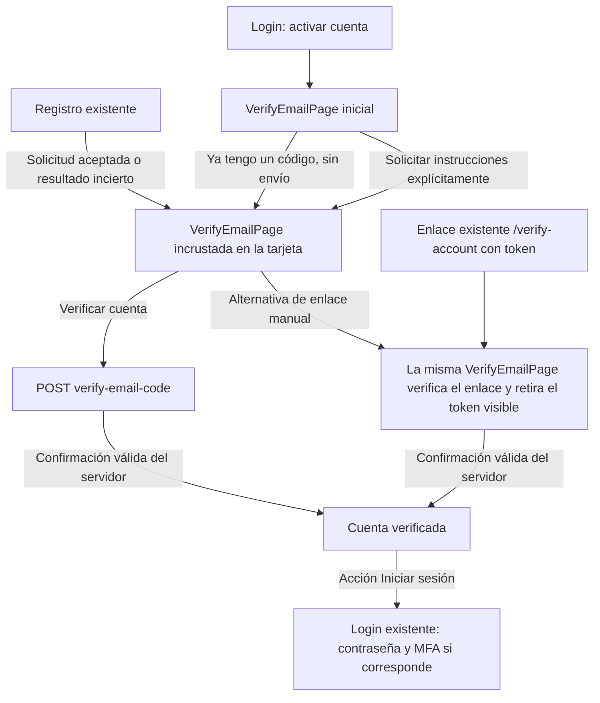

# Activación de cuenta — frontend conectado

Implementación incremental sobre `feature/pen-dev-ui-unification`, HEAD base `c9e7258`. El backend no se modificó. Los pendientes de servidor se documentan por separado en [ACCOUNT_ACTIVATION_BACKEND_AUDIT.md](ACCOUNT_ACTIVATION_BACKEND_AUDIT.md).

Actualización del 18 de noviembre de 2026: esa descripción corresponde a la fase frontend anterior. El endurecimiento posterior se implementó en la rama backend `fix/account-activation-hardening`, sin reconstruir este flujo. Su cierre y los límites de aceptación se documentan en `docs/ACCOUNT_ACTIVATION_HARDENING.md` del backend. Se volvió a comprobar el frontend conectado contra el servidor local; no se modificaron componentes visuales ni contratos REST en esa continuación.

## Una implementación, tres entradas

Se reutiliza **VerifyEmailPage**, su controlador y una única plantilla mediante NgTemplateOutlet. En Registro se renderiza el cuerpo incrustado, sin otro ion-content, cabecera o tarjeta duplicada. No se creó otro AuthService, repositorio, componente OTP ni endpoint.

## Comportamiento

- Tras el registro aceptado se limpia la contraseña y aparece directamente OtpInputComponent. La primera solicitud pudo generar el código; el montaje de la verificación no envía otro correo.
- Si se pierde la respuesta, llega una respuesta 5xx o un cuerpo incompatible, el estado se considera incierto: se ofrece introducir instrucciones existentes sin declarar aceptado el registro. No se repite la petición automáticamente.
- Desde Login, escribir un correo válido no muestra OTP. El usuario elige Ya tengo un código sin envío, o solicita instrucciones. La respuesta neutral no confirma existencia de cuenta.
- El OTP se conserva como cadena de seis dígitos. Pegar/completar no verifica automáticamente. El botón Verificar cuenta o Enter en el formulario realizan la confirmación explícita, con bloqueo de doble activación.
- Correo y código se conservan para recuperación cuando falla la comunicación. Cambiar la dirección cancela la operación de UI anterior y no atribuye su respuesta a la nueva dirección. Cancelar el cliente no revierte lo que el servidor pudo haber procesado.
- Las entradas por código y enlace convergen en el mismo éxito, únicamente tras validar la respuesta real del backend. No se inicia sesión ni se guarda un JWT en estas operaciones.
- El acordeón Usar enlace de activación explica qué pegar. Se conserva emailActionToken y la API configurada: la aplicación extrae el token; no navega al dominio que se pega.
- `/verify-account` carga el mismo componente que `/verify-email`. El token de un enlace entrante se retira de la URL visible antes de procesarlo. Un enlace entrante nuevo cancela la operación anterior. No se añadieron redirecciones externas ni almacenamiento persistente de tokens.
- Las solicitudes de envío y verificación tienen estados/esperas independientes. Retry-After se admite en segundos o fecha HTTP; se conserva remainingTimeSeconds de respuestas existentes. Sin metadatos nuevos, el cooldown de envío es 30 s, conforme al servidor auditado. Es orientación de UX; el backend sigue autorizando cada intento.
- Los contadores no disparan HTTP al vencer y se limpian al salir/destruir. Se limpian códigos y tokens temporales. El cambio del formulario largo de Registro a activación vuelve al inicio del mismo ion-content, sin animación adicional.

## Estados y errores

Signals y formularios reactivos existentes controlan initial, requesting, instructions, entering-code, verifying-code, verifying-link, recoverable-network-error, rate-limited, expired y verified. codeEntry controla la presentación, de forma independiente a una respuesta neutral o un error recuperable. El backend actual agrupa código incorrecto, vencido, usado o sin intentos en HTTP 400: la UI ofrece una explicación conjunta, sin inventar cuál ocurrió. No se deduce existencia/estado de una cuenta por un 200 neutral.

Se presenta un solo error principal por operación. Un error de solicitud de instrucciones se asocia al correo, no al código. Errores de transporte, cuerpo incompatible, 429 y verificación rechazada no generan una confirmación verde. Verificar un enlace muestra progreso visible y accesible, incluso si el acordeón está cerrado.

## Conservación funcional

Se preservaron todos los campos de Registro, normalización, validación de correo/nombres/teléfono, contraseña, límite UTF-8, coincidencia y aceptación legal. No se modificaron AuthService, HttpAuthRepository, el parser de enlaces, guards, recuperación, Login, MFA, NativeSessionStore o MemorySessionStore. OtpInputComponent mantiene su uso en MFA: el envío automático se retiró exclusivamente de la página de activación, no del flujo MFA. No se añadieron librerías ni almacenamiento web de credenciales.

## Archivos de esta intervención

- `src/app/features/auth/connected/connected-register.page.ts` y `.html`: verificación incrustada, resultado incierto, cancelación y restauración al inicio del contenido.
- `src/app/features/auth/connected/verify-email.page.ts` y `.html`: estados, confirmación explícita, reenvío neutral, enlace, espera y limpieza.
- `src/app/app.routes.ts`: alias al componente existente.
- `src/app/core/api/api-error.ts` y `.spec.ts`: lectura compatible de Retry-After y pruebas.
- `src/app/features/auth/connected/activation-flow.integration.spec.ts`: regresiones de activación.
- Los dos documentos de activación en `docs/testing`.

No se rediseñaron pantallas ajenas al alcance. Las modificaciones locales anteriores del repositorio se conservaron.

## Evidencia y límites

Se realizó prueba real con el JAR existente que incluye OTP, Spring Boot local, PostgreSQL desechable y Mailpit; sin modificar fuentes del backend. Desarrollo ordinario conserva navegador→localhost:8080 y emulador→10.0.2.2:8080. La aceptación aislada utilizó frontend 127.0.0.1:14200 → API 127.0.0.1:18083 → PostgreSQL 127.0.0.1:15439. Se comprobó la identidad de la base antes de migraciones. No se reutilizaron credenciales comerciales ni la base productiva.

Los recorridos del navegador realizaron dos registros, una verificación por código y una por enlace, cero reenvíos automáticos y dos correos capturados (uno por registro). Ambas activaciones llegaron al estado confirmado; la prueba por código incluyó Login posterior. Las comprobaciones REST adicionales confirmaron concurrencia de un solo éxito, uso único, cinco intentos y ausencia de sobrescritura. No hay solicitudes a Railway en los arneses de navegador.

Las capturas de estados alternativos usan respuestas sintéticas interceptadas fuera de la aplicación. Las capturas activation-live provienen del backend aislado y nunca muestran códigos o tokens reales. Se comprobaron anchos de 320, 360, 375, 390, 412, 430, 600, 768, 960 y 1280 px, horizontal y texto raíz al 150/200 %. El viewport reducido simula espacio disponible; no se afirma teclado físico Android. adb devices no detectó dispositivos. El alias Angular no configura App Links Android.

No se aplicaron ni se dan por resueltos los pendientes de persistencia del límite IP, cuota global/diaria, entrega ambigua del proveedor o separación del vencimiento OTP/enlace. El backend permanece en solo lectura. No hubo push, merge, despliegue ni cambios Android de versión/firma.

## Validación automatizada final

| Comprobación | Resultado |
|---|---|
| Línea base específica previa | 55/55 |
| Específicas finales: activación, autenticación conectada, repositorio, enlaces, OTP y errores API | 80/80 |
| Integración, repetida sin otras cargas | 255/256 |
| Regresión | 266/266 |
| Suite completa | 885/886 |
| Lint | Aprobado |
| Build Development | Aprobado |
| Build Production | Aprobado |
| test:build-config | 9/9 |

Integración y suite completa conservan el fallo anterior de `public-catalog.integration.spec.ts:393`: la prueba del buscador compacto espera una solicitud predictiva que no aparece. No se modificó Catálogo ni se borró o relajó esa aserción. La primera integración, ejecutada junto a otras cargas pesadas, terminó en 254/256 e incluyó también un fallo de navegación DEMO de Pedidos en `app.routes.integration.spec.ts:185`. Pedidos pasó tanto en la suite completa como al repetir integración aisladamente. Se registra como intermitencia observada, sin atribuirle una causa definitiva ni modificar ese módulo.

Se añadieron 19 pruebas de activación y una de Retry-After. Las evidencias automatizadas quedan en los logs locales ignorados `dist/qa-activation-*.log`. Los builds finales de esta intervención están en salidas de prueba ignoradas: `dist/qa-activation/browser-build` y `dist/qa-activation-production`.

## Entrega visual y Git

La galería `activation-capturas.html` contiene 26 capturas: 21 de estados de presentación con datos sintéticos y 5 del recorrido real contra el backend aislado. Identifica ambas categorías expresamente. No contiene códigos, JWT, claves TOTP ni tokens de activación reales. Los escenarios de error/espera presentados con interceptación no se atribuyen a una reproducción real de fallo del proveedor.

El frontend conserva la rama `feature/pen-dev-ui-unification`, HEAD `c9e7258cf09b1a155dc0cd1340129bfae3412a29`, con cambios locales sin commit de esta intervención y del rediseño anterior. No se crearon ramas, worktrees ni commits. No se modificaron main/develop. El worktree backend preexistente auditado sigue limpio en main, HEAD `30a8c5ab9c85d58fe998935d7725edf3d2d3ba2f`. Los procesos aislados de prueba y PostgreSQL se detuvieron al terminar.
