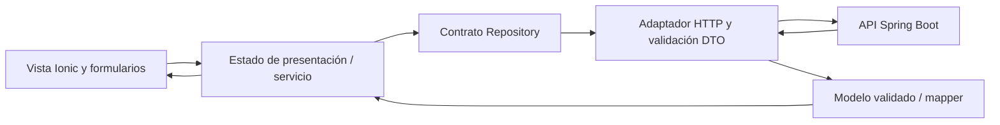

# Integración móvil y estabilización Android

Fecha de revisión: 28/oct/2026, America/Mexico_City. Los logs conservan sus timestamps UTC y pueden mostrar 29/oct.

## Estado de entrega y alcance

**Entrega parcial, preparada para revisión local.** Se corrigen el inicio público, el layout de vistas conectadas y los insets Android; se agrega la integración HTTP de favoritos y se endurece la validación de expiración JWT. Los recorridos autenticados contra Spring Boot, las operaciones comerciales y la verificación en teléfono físico requieren infraestructura/cuentas de prueba autorizadas. Ningún resultado con HttpTestingController se presenta como validación real del servidor.

Stack existente: Angular standalone 22.2, Ionic 9, RxJS, Capacitor 8.5, Android target SDK 36 y Spring Boot/PostgreSQL como backend. No se agregan bibliotecas ni se cambia el lock de dependencias.

Rama de revisión: `feature/actividad-4-integracion-movil`, creada desde el mismo HEAD `efe9767082040971278e66595aad8c0bf82c4b81`, conservando el árbol sin commit. La fuente exacta, archivos modificados y artefactos se identifican en `MOBILE_SOURCE_MANIFEST.json`; el HEAD solo identifica la base, no contiene estos cambios.

## A–B. Causas raíz y correcciones

1. **Inicio incorrecto:** Splash llamaba a `/login` tras 2.5 segundos. Ahora abre `/main/home` con reemplazo del historial. Se cancela el temporizador tanto al destruir como al abandonar la vista cacheada por Ionic, para no sobrescribir un destino abierto mientras se muestra Splash. La raíz conserva la secuencia Splash → Inicio público.
2. **Formulario incompleto:** las páginas de ruta contenían vistas conectadas anidadas sin host `ion-page`. `ion-content` no disponía del contenedor flex de altura completa esperado por Ionic. Se corrige el host de login, registro, recuperación, perfil y checkout conectados. No se aplican zoom, scale ni offsets para ocultar el problema.
3. **Insets desconectados:** Capacitor 8 SystemBars inyecta `--safe-area-inset-*`, mientras los tokens existentes leían únicamente los valores de Ionic/env. Se enlazan explícitamente con `--ion-safe-area-*`, con fallback `env()`. SystemBars queda configurado en modo CSS, barras visibles y estilo claro. Una sola capa aporta cada inset; no se agrega padding nativo duplicado.
4. **Accesibilidad de entrada:** el documento pasa a español y título de la aplicación, mantiene ancho de dispositivo y permite zoom del usuario. Se conserva la tipografía de 16 px en campos y los controles existentes de la marca.
5. **Navegación de invitado:** Inicio ofrece login/registro; login permite volver a Inicio. Las rutas privadas mantienen `authGuard` y retorno interno validado. Perfil y favoritos recargan al volver a entrar en páginas cacheadas.
6. **Regresión de aceptación DEMO:** los flujos existentes ahora comprueban primero Inicio y eligen explícitamente iniciar sesión. Conservan sus verificaciones posteriores. No se usan para acreditar backend real.
7. **Favoritos:** se consume el contrato existente de wishlist, con IDs de producto al agregar e IDs de partida al eliminar. Un producto deshabilitado por el servidor no se anuncia disponible solo porque conserve stock.
8. **Expiración JWT:** el backend emite `exp`; una respuesta sin expiración válida, no finita o ya vencida se rechaza, en vez de permitir inferir una sesión ilimitada. No se modifica el almacén de TT-05 ni se verifica la firma en el cliente: el servidor sigue siendo autoridad.
9. **Tarjetas y filtros:** una captura del APK mostró que la altura intrínseca de fotografías verticales expandía el contenedor con `aspect-ratio`, dejando precio y acciones demasiado abajo. El componente de imagen queda contenido absolutamente dentro de la caja de proporción existente, sin recortar el instrumento (`object-fit:contain`). Los selects usan ancho de su columna y `min-width:0`, evitando solapamientos.

## C. Archivos y preservación

El inventario y respaldo previos están en `reports/mobile-stabilization/before.json` y `before.zip` (148 archivos que ya tenían cambios). No se borraron ni descartaron archivos anteriores. El manifiesto final distingue modificaciones del incremento y trabajo previo intacto.

Estado final: 57 archivos tracked modificados y 119 archivos sin seguimiento, contando todo el trabajo heredado y este incremento; nada staged. De los 148 archivos con cambios iniciales, 128 permanecen byte por byte iguales y 20 recibieron cambios incrementales conservados sobre su contenido. El ZIP previo permanece disponible. `git diff --check` termina con código 0; Git advierte sobre normalización futura LF/CRLF en archivos existentes, sin errores de whitespace.

Grupos principales de cambios:

- Navegación: `src/app/features/splash/splash.page.ts`, su spec, `app.routes.ts`, `app.routes.integration.spec.ts`, Home y sus enlaces.
- Layout/insets: `capacitor.config.ts`, `src/index.html`, `src/theme/variables.scss` y hosts de vistas conectadas de auth/perfil/checkout.
- Favoritos: `core/models/wishlist.model.ts`, `core/repositories/wishlist.repository.ts`, `core/infrastructure/http-wishlist.repository.ts`, `features/favorites/connected-favorites.view.ts`, wrapper de Favoritos y acción de detalle público.
- Catálogo visual: `features/public-catalog/public-product-grid.component.ts` y filtros de `public-catalog.view.ts`.
- Seguridad: `core/api/auth.validation.ts` y sus pruebas de expiración; los archivos de almacenamiento de sesión no se modifican.
- Pruebas: integración conectada de favoritos, carrito/detalle, perfil cacheado, guard, acceso público y arranque; cuatro flujos Maestro DEMO actualizados por el cambio de experiencia.

## D–E. Funcionalidades y nivel de comprobación

| Módulo | Implementación | Nivel de evidencia y pendiente |
|---|---|---|
| Splash/Inicio público | Corregido | APK y pruebas de rutas; no exige identidad para explorar |
| Categorías, catálogo, búsqueda, detalle, novedades y destacados | API pública existente conservada | GET reales y recorrido Android; ver `android-smoke-results.json` para los pasos efectivamente completados |
| Loading, skeleton, vacío, errores y reintento | Implementados | Renderizado Angular y pruebas de errores; el resultado Android offline/reintento se distingue en el registro del recorrido |
| Login/registro/verificación/recuperación/2FA | Flujos HTTP existentes | Unitarias/HTTP simulado; vistas públicas revisables sin enviar credenciales. Falta cuenta local autorizada, buzón y factores |
| JWT/guards/logout | Implementados, expiración endurecida | Pruebas de 401/403, retorno seguro, aislamiento de headers y descarte de sesión; autenticación real pendiente |
| Seguridad de cuenta: EMAIL, TOTP, QR, clave y respaldos | Implementación anterior conservada | Pruebas simuladas; no se generan ni consumen códigos reales en esta ejecución |
| Carrito real | Implementación existente conservada | Pruebas de partidas, cantidades, totales, stock y doble envío con HTTP simulado; requiere cuenta/BD de prueba |
| Cotización/checkout | Cotización existente, escritura bloqueada | `REAL_CHECKOUT_WRITE_ENABLED` sigue false. No se crean pedidos ni pagos |
| Historial/detalle/timeline | Adaptadores existentes | Mocks y validación cliente; falta comprobar propiedad con dos cuentas sintéticas |
| Perfil | Lectura y recarga al reentrar | Mocks; edición de autoservicio sigue pendiente por ausencia del PUT correspondiente en backend |
| Favoritos | GET/POST/DELETE reales implementados, ruta protegida | Contrato leído y HTTP simulado; GET anónimo real rechazado. Alta/eliminación autenticadas reales pendientes |
| Sesión persistente | No incorporada | Memoria volátil existente; TT-05 mantiene esa responsabilidad |

## Conectividad comprobada y entornos

Se distinguen cuatro superficies:

- **Windows:** `127.0.0.1:8080/actuator/health` respondió 200/UP; categorías 200/10 elementos; catálogo 200/68 productos. Evidencia sanitizada: `reports/mobile-stabilization/connectivity-windows.json`.
- **Chrome del emulador:** el intento de apertura llegó a FirstRunActivity. No se atribuye una respuesta de health al navegador sin haberla observado; ese paso queda pendiente de completar el arranque inicial del navegador.
- **APK:** el origen local observado es `https://localhost`, mientras las peticiones públicas se dirigen a `http://10.0.2.2:8080`. Las métricas de recurso de la WebView registraron 200 para categorías/latest/featured. El protocolo de diagnóstico Android se usó por ADB; no se controló la ventana independiente de DevTools de Windows que había sido bloqueada.
- **Producción:** configuración HTTPS separada de desarrollo; build verificado, sin peticiones o cambios de producción. No hay fallback automático local/producción/DEMO.

El listener/perfil explícito que se pudo observar se registra en `backend-listener.json`. Si no existe un flag verificable, no se deduce el perfil activo desde los archivos fuente. El backend consultado como referencia se encuentra en otra rama con cambios locales; no se establece identidad entre ese árbol y el proceso ejecutado.

El CORS local admite `https://localhost`. Android conserva permiso Internet y la excepción Debug limitada a `10.0.2.2`; no se añade cleartext general ni trust-all TLS. La variante Release no debe heredar el recurso de seguridad de Debug. Para un teléfono físico, `10.0.2.2` no representa el equipo Windows: requiere un host LAN explícito y una excepción Debug acotada, o un backend HTTPS de pruebas acordado. Esa prueba no está acreditada por el emulador.

## F–G. Pruebas y APK

Los resultados finales se detallan en `MOBILE_SOURCE_MANIFEST.json` y los logs `reports/mobile-stabilization/`:

Resultado de la fuente final: lint satisfactorio; **507 pruebas en 62 archivos**, **116 casos de integración simulada** y **141 de regresión**. Son suites que se solapan, no 764 casos únicos. Cobertura: instrucciones **94.50%**, ramas **92.97%**, funciones **91.72%**, líneas **97.83%**. Builds Angular development/production, Capacitor sync y Gradle Debug satisfactorios; producción conserva ocho avisos previos de presupuesto CSS, sin reducir los umbrales.

El APK instalado se extrajo del emulador y su SHA-256 coincide con el compilado: `de90712e7e1db884111d60286ad0625e5a7bfd33f8d855726ef9987ce1804641`. VersionCode 1/versionName 1.0 no distinguen por sí solos este incremento; el hash y lastUpdateTime sí identifican el artefacto observado.

| Tipo | Comando/evidencia | Interpretación |
|---|---|---|
| Lint | `npm run lint` / `lint.log` | Comprobación estática |
| Unitarias | `npm test -- --watch=false --runner-config=reports/mobile-stabilization/vitest.serial.config.mjs` / `tests.log` | Todos los casos; un solo worker |
| Cobertura | `npm run test:coverage -- --runner-config=...` / `coverage.log` y `coverage/app/coverage-summary.json` | Instrucciones, ramas, funciones y líneas del código instrumentado |
| Integración simulada | `npm run test:integration -- --runner-config=...` / `integration.log` | Router/componentes/repositorios y HttpTestingController; no servidor real |
| Regresión | `npm run test:regression -- --runner-config=...` / `regression.log` | Casos existentes y ampliados del alcance configurado |
| HTTP real | `connectivity-windows.json`, métricas de WebView y recorrido Android | GET públicos y rechazo anónimo, sin credenciales ni mutaciones |
| Builds | `build-production.log`, `build-development.log`, `cap-sync.log`, `android.log` | Compilación, sincronización y APK Debug; no prueba visual por sí sola |
| APK instalado | Hash del APK y copia instalada en el manifiesto; `android-smoke-results.json` | Sólo se acreditan los pasos completados por el APK instalado |

La pasada concurrente tuvo tres timeouts, conservados en `tests-concurrent-failed.log`. Se reprodujo la ejecución con un solo worker mediante configuración explícita (`maxWorkers:1`, `fileParallelism:false`), sin excluir casos, agregar skips, rebajar expectativas ni aumentar timeouts. Los resultados de la pasada final son los que deben utilizarse. El archivo de configuración y su hash se conservan con las evidencias locales; debe incluirse una configuración reproducible acordada al preparar el PR.

Una repetición posterior no llegó a ejecutar casos por errores EPERM al renombrar temporales dentro del sandbox (`tests-sandbox-failed.log`). Se repitió con acceso normal a cachés. Es un fallo del entorno, registrado y separado del resultado final; no se modificaron casos para ocultarlo. En Android apareció además un aviso «Process system isn't responding» del sistema del emulador, que interceptó toques; se eligió Esperar antes de continuar.

Se cubren arranque público, cancelación de temporizador al abandonar Splash cacheado, rutas privadas, retorno al destino, 401/403, sesión vencida, login/2FA y formularios inválidos; catálogo vacío/offline/malformado, stock, cantidades/totales, cancelación de consultas, favoritos y recarga de perfil. Las cifras no acreditan comportamiento del servidor ni cobertura nativa Android. Ninguna prueba antigua se eliminó.

### Responsividad y límites de la inspección

Se capturaron perfiles Android 320×568, 360×800, 393×852, 412×915 y tableta 800×1280, modificando temporalmente el display del emulador y restaurándolo. Se verifica en la vista de login, no se presenta como una matriz visual exhaustiva de todos los módulos.

La matriz geométrica no detectó overflow horizontal. **Orientación: validación visual pendiente.** Se observaron métricas 914×411, pero una captura conservaba contenido de retrato tras la rotación y el intento adicional de inspección agotó el tiempo RPC. No se incluye esa imagen como evidencia aprobada. `android-layout-results.json` está marcado parcial para distinguir geometría de calidad visual. El emulador debe volver a comprobarse con compositor estable o dispositivo físico. Las capturas de 320 px y tableta se repitieron esperando la actualización nativa; en 320 px el formulario necesita desplazamiento vertical normal.

La WebView a tamaño físico observó viewport 411×914, campos de 16 px, documento de 411 px y scroller de 411 px de ancho: sin overflow horizontal en esa comprobación. Los insets superiores/inferiores son dinámicos y no offsets CSS fijos.

El recorrido del APK final completó Inicio, categoría Jaranas, búsqueda HTTP, producto 313, retorno al catálogo, guard de carrito → login con `returnUrl=/main/cart`, registro/recuperación/verificación sin envío, error offline y recuperación al reintentar. Se conservaron capturas públicas sanitizadas en [android/](android/): [Inicio](android/inicio-publico.png), [catálogo](android/catalogo-real.png), [detalle](android/detalle-producto.png), [login](android/inicio-sesion.png), [registro](android/registro.png), [recuperación](android/recuperacion.png), [verificación](android/verificacion.png), [error de red](android/sin-conexion.png), [catálogo recuperado](android/catalogo-recuperado.png). El manifiesto incorpora las mediciones por paso.

El IME del dispositivo presenta una barra flotante al enfocarse; se confirmó su estado visible y se conservó captura, pero no se acredita con ello el redimensionamiento de un teclado completo. La prueba de teléfono físico, TalkBack y todos los escenarios de cámara/teclado siguen pendientes. Las capturas de formularios no contienen credenciales.

## H. Seguridad y riesgos residuales

- Sin cambios al backend, sin pagos, pedidos, registros de usuarios ni mutaciones reales de favoritos durante esta ejecución.
- JWT sólo en el almacén volátil existente; no localStorage. El interceptor conserva el destino acotado al backend configurado y las rutas públicas no reciben token.
- Las respuestas remotas se validan y el texto se interpola como datos. Imágenes: orígenes esperados mediante mapper; secretos de TOTP/respaldo no se envían a servicios externos ni se incluyen en estas evidencias.
- El cliente no sustituye la autorización del servidor. Rechazo anónimo 401 no demuestra aislamiento entre dos usuarios; ese ensayo requiere cuentas sintéticas autorizadas.
- Siguen pendientes persistencia segura TT-05, reautenticación fuerte de cambios MFA cuando la exija el contrato, gestión de secretos al pasar a segundo plano/capturas del sistema y pruebas reales de correo/TOTP/consumo de respaldos. Consultar `AUTH_PHASE1_MFA.md`.
- El enlace backend de verificación a localhost y la edición de perfil necesitan coordinación con el backend; no se inventan endpoints para resolverlos.
- Logcat conserva errores tempranos de Capacitor al intentar inyectar safe-area antes de existir el documento, además de avisos Chromium/MESA/SurfaceSync del emulador y el error durante la prueba offline. Los insets posteriores observados son correctos; no se afirma una consola limpia ni se modifica código del proveedor para ocultar mensajes. Requiere seguimiento de arranque/rotación en dispositivo físico.
- El paquete Debug informa `ALLOW_BACKUP`; revisar exclusiones de copia y política de capturas junto con TT-05 antes de persistir secretos. En este incremento no se agrega persistencia de JWT ni de factores.
- Advertencias de mixed content sólo corresponden al desarrollo local Debug. No se ejecutó un APK Release ni se declara ausencia total de vulnerabilidades.

## I. Arquitectura y patrones sustentados

Arquitectura Angular por funcionalidades con separación de presentación, estado/aplicación, modelos, contratos y adaptadores. Equivalencia parcial con MVVM: las vistas enlazan estado reactivo y servicios como `PublicCatalogService`; otras vistas todavía coordinan sus solicitudes directamente. **No se afirma Clean Architecture ni MVVM completos**: existen contratos/tokens Angular enlazados con adaptadores de infraestructura y no todo el dominio es independiente del framework.

| Patrón | Evidencia de utilidad |
|---|---|
| Repository | `PublicCatalogRepository`, `WishlistRepository` y adaptadores HTTP. Sustitución del acceso en pruebas sin alterar las vistas |
| Simple Factory | `DemoOrderFactory.create` valida y construye pedidos del recorrido DEMO explícito; no fabrica pedidos comerciales en frontend |
| Singleton por DI | Clientes/adaptadores y servicios con `providedIn:'root'`, compartidos por inyector |
| Observer | RxJS/Signals, `switchMap` para consultas, eventos de fin de sesión para descartar favoritos/datos del usuario |

El incremento de favoritos agrega un contrato y modelo propios, valida las respuestas y mantiene la identidad del usuario en el token, sin enviar un `userId` manipulable. La lógica comercial de stock/importes sigue en el servidor.

## J–K. Trazabilidad y Git

| Trabajo | Elementos existentes | Evidencia / aceptación |
|---|---|---|
| Inicio público y navegación | HU-04 #4; TT-04 #18 | Splash, rutas, guards, pruebas y APK. TT-04 ya figura cerrado; no se modifica su estado |
| Catálogo/búsqueda/detalle | HU-05 #5, HU-06 #6, HU-07 #7; TT-03 #17 | GET públicos y pruebas, sin afirmar compra completa |
| Favoritos | HU-08 #8; TT-30 #46; dependencias TT-03/05/06 | Integración local y pruebas simuladas; aceptación real autenticada pendiente |
| Regresión/cobertura/evidencias | TT-42 #61, TT-44 #63, TT-48 #67, TT-50 #69 | Logs y manifiesto actuales; sin check remoto nuevo |
| Persistencia segura | TT-05 #19 | Rama y almacenamiento ajenos preservados; no se sustituye su implementación |

La consulta de HU-08 confirma que está abierta y asignada a IvanRamirezFrancisco. TT-04 está cerrado y asignado a IvanRamirezFrancisco/Tackalay. Los PR #71, #77 y #80 de Tackalay continúan abiertos y no se alteraron. Hay solapamiento funcional con registro, recuperación y perfil: se requiere revisión conjunta antes de integrar, no reescritura de sus ramas.

Se comprobó la inexistencia de rama remota/PR con el nombre propuesto antes de crear la rama local. No se hizo commit, push, merge, deploy, cierre de Issue ni actualización del Project. Los cambios previos sin commit no se atribuyen a personas mediante inferencias; su preservación se acredita con el respaldo y comparación de hashes.

Los campos personalizados y vistas de GitHub Project no se presentan como verificados en esta ejecución. La consulta anterior devolvió 404 y el snapshot histórico de Issues no equivale a Status/Iteración XP/Etapa DevOps del Project. Propuesta para revisión: vincular evidencia local a los elementos existentes, conservar responsables y no marcar Done hasta contar con revisión y pruebas exigidas. No se inventan opciones o IDs del Project.

## L–M. Verificación manual y siguiente revisión

1. Usar el APK Debug de este manifiesto y comprobar que el hash instalado coincide; abrir/cerrar/reabrir: Splash → Inicio.
2. Sin sesión, abrir Jaranas/catálogo, buscar, navegar al detalle y volver. Comprobar precio, disponibilidad y errores/reintento con conexión restablecida.
3. Abrir carrito/perfil/favoritos sin sesión: debe solicitar login conservando el destino. Revisar registro, recuperación y verificación sin enviar datos reales.
4. Completar Chrome inicial del emulador y probar health en `10.0.2.2`, no en el navegador Windows. Completar teclado completo, orientación y teléfono físico.
5. Proporcionar una cuenta local sintética autorizada, buzón y confirmación de BD aislada antes de validar login/MFA/carrito/favoritos/cotización. No habilitar pedidos/pagos productivos.

El usuario confirmó que no dispone todavía de cuenta sintética/buzón autorizados ni de confirmación de aislamiento de la BD local. Por ello sólo se ejecutaron lecturas públicas y rechazos anónimos: no se registraron usuarios, no se solicitaron correos ni se modificaron favoritos, carrito, seguridad, pedidos o pagos en el backend. Las operaciones privadas se prueban con respuestas controladas.

Preparación de PR posterior: revisar el diff completo contra develop (incluye todo el trabajo previo aún sin commit), acordar las superposiciones con Tackalay y TT-05, versionar únicamente fuentes y evidencias sanitizadas acordadas, ejecutar CI sobre el futuro SHA y adjuntar aprobación. Títulos por funcionalidad: navegación pública, layout Android, favoritos, expiración JWT y evidencias. No usar autocierre de historias cuya aceptación real siga pendiente. Confirmar con el docente la admisión de Ionic/Angular/Capacitor si el instrumento enumera otras tecnologías.
