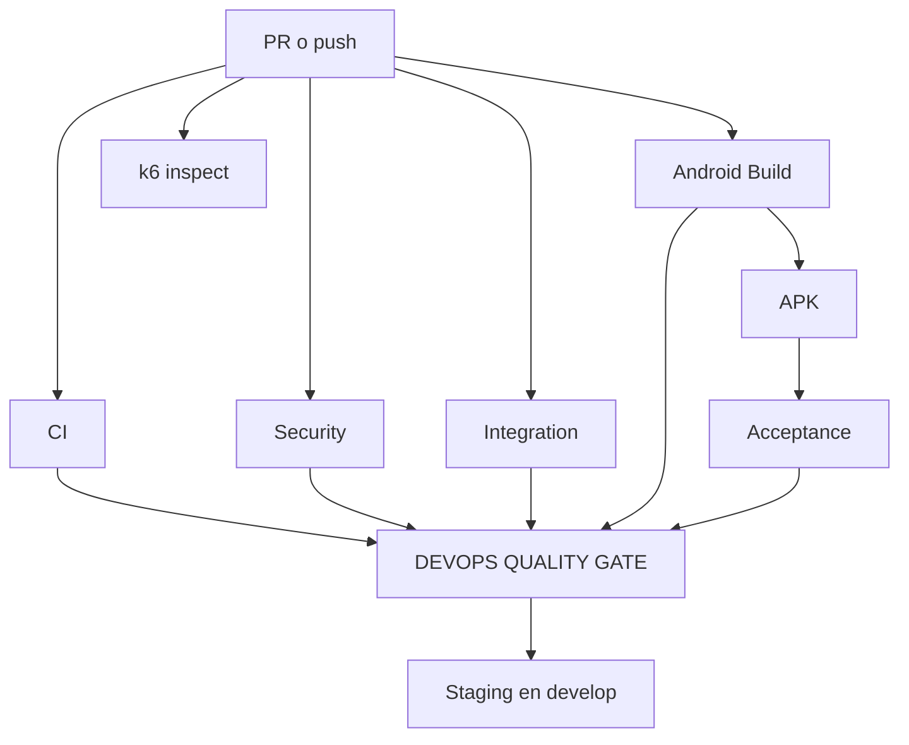

# ESTÁNDAR DE EJECUCIÓN DE PRUEBAS POR EVENTO DEVOPS

La política se aplica por evento y SHA, no por cada función o HU aislada. Las HU determinan trazabilidad y datos; el evento decide qué controles se ejecutan. El modelo es híbrido: trabajos independientes corren en paralelo y las etapas con artefacto/dependencia corren en secuencia.

| EVENTO | WORKFLOWS | PRUEBAS / CONTROLES | PARALELO / SECUENCIAL | BLOQUEANTE | QUALITY GATE | ARTIFACT | RESPONSABLE |
|---|---|---|---|---|---|---|---|
| Pull Request a `develop`/`main` | CI, Security, Integration, Android→Acceptance, Performance inspect | Unitarias, lint/compiler/build, coverage, audit/CodeQL, integración frontend, APK, Maestro DEMO, sintaxis k6 | Cinco workflows en paralelo; Android→APK→Acceptance secuencial; gate espera seis checks | Sí para seis checks y gate; k6 remoto no se ejecuta | `DEVOPS QUALITY GATE` consolida el mismo SHA y actualiza un único comentario del PR | Coverage/JUnit, APK, Maestro, gate JSON | Autor corrige; revisor evalúa evidencia |
| Push/merge a `develop` | Los mismos controles pertinentes + Staging | Repite controles del SHA integrado; entrega solo después del gate | Controles en paralelo; gate → staging secuencial | Sí | Staging consulta `DEVOPS QUALITY GATE` del mismo SHA; si falta/falla no construye entrega aprobada | Gate JSON y APK staging | IvanRamirezFrancisco / revisor |
| Push/merge a `main` | CI, Security, Integration, Android→Acceptance, Performance inspect | Controles obligatorios y build candidato | Paralelo con secuencia Android→Acceptance | Sí | Gate del mismo SHA; release publicado/Play Store sigue fuera de alcance | Evidencias anteriores | Equipo y revisor |
| `workflow_dispatch` Integration | Integration | Contrato API real de la suite seleccionada | Configuración → API secuencial; frontend independiente | API bloqueante solo si fue habilitada | Resultado manual complementa, no reemplaza gate cotidiano | JUnit API | IvanRamirezFrancisco |
| `workflow_dispatch` Regression | Regression→Android→Acceptance | Regresión crítica completa | Completamente secuencial entre etapas; pruebas internas administradas por Vitest/Maestro | Sí dentro del run | Evidencia adicional para cierre de XP/entrega | JUnit, APK y Maestro | Tackalay + IvanRamirezFrancisco |
| `workflow_dispatch` Performance | Performance | LOAD o STRESS, nunca ambos accidentalmente | Validate/configuration → escenario seleccionado | Thresholds bloqueantes en la ejecución real | Manual/condicional; no required cotidiano | JSON de serie/resumen | IvanRamirezFrancisco ejecuta; Tackalay analiza |

## Resultado y acción

- **PASS:** el control se ejecutó y cumplió su criterio; permite la etapa dependiente.
- **FAIL:** el control se ejecutó y no cumplió; el job falla y las etapas con `needs` no continúan.
- **BLOCKED:** falta una condición externa identificada; no acredita prueba ni habilita entrega.
- **SKIPPED:** el evento no debía ejecutar el control; no equivale a aprobación.

El audit completo puede ser informativo mediante `continue-on-error`; el audit de producción continúa bloqueante y la diferencia aparece en el Step Summary. No se usa `continue-on-error` en unitarias, integración frontend, build Android, aceptación, gate, API habilitada ni k6 real.

## Dependencias reales

`Regression critical → Android critical → Acceptance` y `Configuration → API` son secuencias independientes/manuales. `k6 validate + configuration → LOAD o STRESS` es otra secuencia manual. No se describe una dependencia entre workflows que el código no implemente.

## Retroalimentación

Cada workflow escribe en `$GITHUB_STEP_SUMMARY`: workflow, evento, SHA, rama, PR, controles, datos/ambiente, resultado, métricas, artifacts, estado general y acción recomendada. El gate publica JSON y mantiene un solo comentario marcado en el PR; se actualiza en cada SHA en vez de generar ocho comentarios. Los logs/annotations conservan el detalle técnico.
